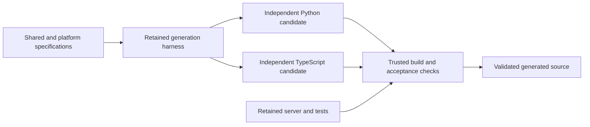

# Design and ownership

Status: CHG-001 desktop evolution verified; 55 acceptance cases, nine harness guards, and clean regeneration pass. [Decisions](docs/DECISIONS.md) record provenance; [status](docs/STATUS.md) separates readiness and evidence.

## Your design priorities

Leave preferences blank to use the adjacent defaults. These fields express priorities; the agent maintains the technical design below.

<!-- USER:BEGIN DESIGN_CHOICES -->
| ID | Question | Your input | Example / automatic default |
|---|---|---|---|
| D01 | What is the priority order? | | Correct offline behavior, clean regeneration, readable specifications, implementation simplicity, then visual polish. |
| D02 | How much server complexity is acceptable? | | One local Python process with in-memory state; no server database or authentication service. |
| D03 | What dependency policy should guide the agent? | | Prefer standard libraries and small general-purpose tools; no turnkey messaging SDK and no runtime CDN. |
| D04 | What reliability limitation is acceptable? | | Delivery guarantees apply within one continuously running server session; restart the demo with explicit fresh client stores after server restart. |
| D05 | What tradeoff should resolve routine design choices? | | Prefer a small understandable solution over a reusable abstraction unless the abstraction is necessary for the code-generation harness. |
<!-- USER:END DESIGN_CHOICES -->

## Architecture and principles

Specs determine behavior; independently authored retained tests establish observable expectations before client generation. The generic harness reads registered Markdown and configuration, invokes the chosen coding tool, validates isolated candidates, and publishes source only after checks. The harness owns paths, execution, integrity, and evidence; it contains no messaging business logic or finished client templates.

At runtime, each client has presentation, validation, durable storage, transport, and one synchronization scheduler. Python uses standard-library HTTP and SQLite with short locked transactions; the browser uses fetch and IndexedDB. They share written schemas and tests, not implementation modules. One retained Python HTTP server serves browser files and maintains in-memory streams/receipts under one lock. HTTP polling is sufficient for the small local scope and keeps transport faults observable.

Durable enqueue precedes network dispatch. Stable IDs let the server distinguish retries from new submissions. The server stores accepted messages for its entire session; retrieval is nondestructive, so an interrupted receiver can retry before committing a cursor. A single client receive transaction preserves inbox/cursor consistency. Each recipient has a contiguous sequence; local outgoing order is independent of server sequence. Outgoing accepted means server acceptance only.

One send and one incoming page per cycle balance outgoing FIFO with receive progress during a send failure. A five-second total request deadline and one-second cycle delay bound interaction without a complex backoff framework. A single scheduler eliminates overlapping cycles; network work never holds a local storage lock. Browser reset invalidates late responses to protect a new identity.

## Tradeoffs and boundaries

| Decision | Benefit | Limit |
|---|---|---|
| In-memory server | Small, auditable protocol implementation | New server process requires explicit fresh client stores; no durable server recovery |
| Polling HTTP/JSON | Simple independent clients and fault injection | Foreground latency and background browser scheduling limitations |
| SQLite / IndexedDB | Native durable local queues | Storage denial/eviction and disk failure cannot be eliminated |
| One active identity instance | Avoids account/multi-device coordination | Shared-tab or multi-device concurrency is unsupported |
| Exact schemas and byte limits | Consistent cross-language boundaries | Extensions must be explicitly specified and registered |
| Independent retained tests | Common behavior checked without shared client code | Optional forced-crash/write-failure paths remain unverified until exercised |
| Staged publication | Failed generations preserve usable source | Requires disposable workspaces and integrity manifests |

No authentication, production security, network exactly-once guarantee, server database, push notifications, offline browser asset cache, or unrequested feature is included. A specification change may later extend these limits through [FUTURE.md](FUTURE.md), whose completed CHG-001 desktop change is archived in [CHANGES](docs/CHANGES.md).

## Dependency rationale

Python 3.10+ standard libraries cover server, harness, SQLite client, and unittest. Node.js 22+ runs build/test tooling. Select exact TypeScript 5.9.3 and retained `@playwright/test` 1.56.1 with its matching Chromium for a reproducible compiler/browser test pair. Their upstream releases exist; the selected compiler/browser pair is installed and the expanded baseline passes. See [TypeScript release](https://github.com/microsoft/TypeScript/releases/tag/v5.9.3) and [Playwright release](https://github.com/microsoft/playwright/releases/tag/v1.56.1).

Real package-manager locks are committed; tested versions are recorded in STATUS. The generation CLI is a separate development dependency; select and pin a version only after an authenticated readiness check in the harness environment. Do not infer current account access from installed binaries or successful work in another project. The desktop requires native tkinter/Tcl/Tk packages; retained GUI tests require Xvfb and X11 utilities. No pip package or cloud messaging service is required. README and TESTING list the exact Ubuntu/WSL installation command.

## Authorship and regeneration ownership

| Artifact | Ownership boundary | Actual authorship/evidence |
|---|---|---|
| Instruction_for_Agent.md | Retained construction guide | User-supplied guide revised by the agent with user authorization; commit 216ef72 |
| Root docs, specs/, docs/ | Retained contracts and workflow | Agent-authored in Stage 1 and reconciled with actual Stage 2 implementation/evidence; no user field values were invented |
| USER preference cells | User-owned inputs | All 26 blank; adjacent defaults resolved separately |
| M01–M06 | User-owned factual observations | Blank; no manual results recorded |
| generator/, server/, tests/, scripts/ | Retained during client generation | Parent coding agent authored retained infrastructure/tests; actual commits record milestones |
| generated/python-client/, generated/typescript-web/ | Deletion/regeneration boundaries | Separate actual Codex 0.166.0 / requested gpt-6-astra harness calls; Python regenerated for the page-limit regression and CHG-001 desktop GUI |
| Dependency locks / compiled assets | Locks committed / builds disposable | npm created committed locks; TypeScript/Node produced disposable browser assets |

Retained does not mean human-written. Do not invent authors, dates, commits, verification runs, or an old project lineage. Stage 2 records actual commands, input/test hashes, repairs, and generated source provenance. A release archive includes authentic history and excludes credentials, stores, caches, and old source-bearing transcripts; verify restoration before marking archive completion.

## Desktop presentation (CHG-001)

Tkinter/ttk supplies the Python desktop window. The GUI and retained --machine interface use the same generated Python messaging core; the browser implementation remains independent. Tk owns the main thread, while one bounded synchronization worker exchanges committed snapshots through scheduled UI updates. SQLite version 1 remains compatible with pre-GUI stores. Actual-widget tests complement existing machine protocol tests. Native Tcl/Tk and automated Xvfb prerequisites are installed/reported separately from Python packages. Evolution verification must preserve generic orchestration/prompt hashes and regenerate from the revised specifications; CHG-001 execution passed, with exact fingerprints and commands in [CHANGES](docs/CHANGES.md).
